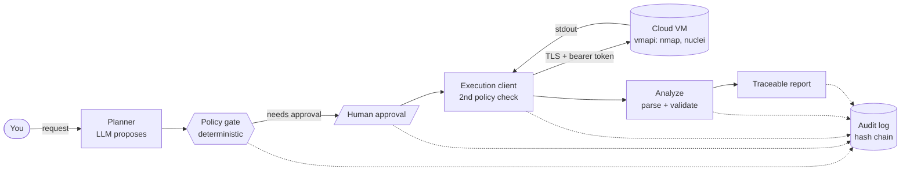

<div align="center">

# Viper

**A human-controlled AI copilot for authorized penetration testing and bug-bounty research.**

It plans a test, asks you to approve it, runs approved tools on a separate cloud VM, turns the raw output into
validated findings, and writes a report where every claim traces back to a tamper-evident audit log.

[](https://github.com/jellaharshith/Viper_Security/actions/workflows/ci.yml)
[](https://github.com/jellaharshith/Viper_Security/actions/workflows/security.yml)

[](LICENSE)

</div>

> [!WARNING]
> Viper is for **authorized** testing only: your own systems, intentionally vulnerable labs, or targets with written
> permission. Active testing is **off by default** and every active action needs an explicit human approval.
> See [Responsible use](#responsible-use).

## Why Viper

Most "AI pentest" tools let a model decide what to attack. Viper does the opposite: **the model proposes, deterministic
code decides, and a human approves.**

| Principle | How it is enforced |
|---|---|
| The model never grants permission | `viper.policy` is plain code. LLM text cannot raise a risk level, add a target, or approve itself. |
| Default-deny scope | Anything outside the engagement scope file is refused, and re-checked on the VM. |
| Human in the loop | Active actions pause at an approval checkpoint bound to the exact tool, arguments, scope revision and expiry. |
| Findings are evidence, not guesses | `confirmed` is set only from parser evidence in real tool output, never from LLM text. |
| Traceable | Reports cite audit events by hash. The audit log is a SHA-256 hash chain; findings are re-derived from audited output digests. |
| Safe to stop | Pause, take over, or emergency-stop a running job (the whole process tree is killed and verified). |

## How it works



- **Local plane** (your laptop, CPU only): chat with cited RAG answers, the LangGraph agent, the policy engine.
- **Execution plane** (a separate cloud VM, no public IP): the only place security tools run. Reached over an
  IAP-tunnelled SSH port-forward; bound to loopback with TLS and a bearer token.
- **Knowledge pipeline**: weekly gated RAG refresh from CISA KEV, MITRE ATT&CK and the OWASP Top 10.

Full design: [`docs/architecture.md`](docs/architecture.md) and [`docs/security-design.md`](docs/security-design.md).

## Status

| ID | Milestone | State |
|---|---|---|
| M0 | Foundation: skeleton, config, logging, tests, docs | Done |
| M1 | Local chat + cited RAG | Done |
| M2 | Evaluation harness + baseline | Done |
| M3 | Weekly RAG automation with gates and rollback | Done |
| M4 | QLoRA fine-tune (gated by M2) | Decided: do not train |
| M5 | LangGraph agents + policy engine | Done |
| M6 | Cloud execution plane: approve, watch, take over, pause, emergency-stop | Done, live-validated |
| M7 | Pentest copilot: planner, finding validation, traceable report | Done, live-validated |
| v1.0 | v1.0: live nuclei, scope reader, weekly KB refresh | Done, security-reviewed and live-validated (nmap + nuclei on a real VM) |
| v1.1 | v1.1: multi-format reports, real RFC-3161 anchoring, scope limits | Done, security-reviewed and lab-validated |

M7 was validated against `scanme.nmap.org` on 2026-11-08 (see [`docs/development-progress.md`](docs/development-progress.md)).
For complete v1.0/v1.1 specifications and the v1.2 backlog (OWASP ZAP, noVNC, and lab items), see [`docs/v1-scope.md`](docs/v1-scope.md).

### Validated on

On 2026-11-09, Viper v1.1 was validated end to end against a real deployment of **OWASP Juice Shop 20.4.0** hosted on a throwaway GCP spot VM (`e2-medium`, Ubuntu 22.04, loopback port 80, IAP tunnel) driven by the local Foundation-Sec 8B GGUF model through Ollama under an LLM-drafted, human-approved scope (see [`docs/real-test-1.md`](docs/real-test-1.md)).

**Honest findings & detection results:**
- **Recall:** **2 of 6** ground-truth items found (G1 open HTTP port, G3 missing HTTP security headers with CWE-693). G2 technology detection fired in direct probes but did not reproduce in the final run due to target application-layer rate limiting. G4–G6 (exposed `/ftp`, `/metrics`, and `/api-docs`) fell outside the frozen `tech,misconfig` profile, defining an area for v1.2 profile expansion.

**Safety properties held unconditionally:**
- **Zero false confirmed findings:** 0. Both reported findings were re-derived from audited scanner stdout.
- **Zero out-of-scope actions:** 0. Exactly two tool dispatches (`nmap`, `nuclei`), both strictly targeting the approved `127.0.0.1` target.
- **Rate limits enforced:** The approved 5 rps scope rate limit was respected by tool invocation.
- **Audit chain & real anchor verified:** `viper audit verify` confirmed full chain continuity and reported `VERIFIED` on a real DigiCert RFC-3161 timestamp token evaluated offline via OpenSSL.
- **Multi-format reports generated:** Markdown, JSON (`viper-report/1`), and SARIF 2.1.0 reports were generated with valid audit citations.
- **Negative boundary test passed:** A hostile scope document banning automated tools resulted in `automation_allowed: false` with ambiguity warnings; the agent denied both proposed actions with `automated tools are not permitted by this scope` and executed zero commands.

## Quick start

Requires Python 3.12+. The local model runs through [Ollama](https://ollama.com).

```powershell
git clone https://github.com/jellaharshith/Viper_Security.git
cd Viper_Security
python -m venv .venv
.\.venv\Scripts\python.exe -m pip install -r requirements-dev.txt -e .
copy .env.example .env          # then edit; never commit .env
.\tasks.ps1 check               # ruff + mypy + pytest
.\tasks.ps1 health              # redacted config
```

On macOS/Linux use `source .venv/bin/activate` and call `viper ...` (or `python -m viper.cli ...`) directly.

### Ask a question (cited RAG)

```powershell
ollama pull nomic-embed-text
ollama pull hf.co/fdtn-ai/Foundation-Sec-1.1-8B-Instruct-Q4_K_M-GGUF:Q4_K_M   # ~4.9 GB
# set VIPER_OLLAMA_MODEL=<that model name> in .env
python -m viper.cli ingest-kev
python -m viper.cli chat "What is CVE-2021-44228?"
```

Answers cite numbered sources; if nothing relevant is retrieved they are labelled `UNVERIFIED`.

### Scope reader (draft and approve)

Bug bounty programs publish written rules and target lists in unstructured text. Viper's scope reader parses them into a strict, machine-enforceable `Scope` file:

```powershell
# 1. Let the local model draft a structured scope from written program rules
python -m viper.cli scope draft --text-file rules.txt --project myproject --program-url "https://example.com/bounty" --out projects/drafts

# 2. Inspect the draft and ambiguity warnings (the draft has status: DRAFT and is rejected by agent run)
cat projects/drafts/myproject.draft.yaml

# 3. Explicitly approve and publish the final scope (audited with a scope_approved event)
python -m viper.cli scope approve --draft projects/drafts/myproject.draft.yaml --confirm myproject
```

The model drafts the scope from program rules, but the resulting draft is **inert** (`status: DRAFT`) and cannot be used by the agent runner. It becomes active only after a human reviews it and runs `scope approve --confirm <project>`, which records a `scope_approved` event in the tamper-evident (hash-chained) audit log before publishing the final `.scope.yaml` file.

### Run an agent workflow (dry-run by default)

```powershell
# 1. plan: from a JSON plan file, or let the local model propose one with --llm
python -m viper.cli agent run --scope projects/lab-scanme/scope.yaml `
    --plan projects/lab-scanme/plan.json --thread lab1
# OR with the opt-in LLM planner:
python -m viper.cli agent run --scope projects/lab-scanme/scope.yaml `
    --llm --request "scan scanme.nmap.org for open web ports" --thread lab1
# 2. approve the pending action (shows tool, arguments and hash first)
python -m viper.cli agent resume --scope projects/lab-scanme/scope.yaml --thread lab1 --decision ALLOW
# 3. read the report and verify the audit trail
python -m viper.cli report --thread lab1
python -m viper.cli audit verify --project lab-scanme
```

Without an execution plane configured, approved actions run as **dry-run stubs** and nothing touches the network.
To run real tools, deploy the execution plane with
[`docs/plans/m6-gcloud-vm-setup.md`](docs/plans/m6-gcloud-vm-setup.md) and set the `VIPER_EXEC_*` variables
(see [`.env.example`](.env.example)). Real execution additionally requires `VIPER_ALLOW_ACTIVE_TESTING=true`.

### Live scanning

When configured for real execution (`VIPER_ALLOW_ACTIVE_TESTING=true`), tools run **only** on a remote execution plane (a headless GCP Kali VM with zero public ingress):
- **Nmap**: Authorized TCP port discovery with service detection against in-scope targets.
- **Nuclei**: Benign, HTTP-only vulnerability and technology detection with a frozen safety profile: protocol restricted to `-pt http`, tags `tech,misconfig`, excluded tags `dos,fuzz,intrusive,bruteforce,rce,sqli,xss`, severities `info,low,medium`, bounded rate (`-rl 5`), no interactsh, no redirects, and root-owned read-only templates.
- **VM Bootstrap**: Automated via [`deploy/vm-bootstrap.sh`](deploy/vm-bootstrap.sh) (installs Nmap, verified Nuclei release, sets up unprivileged `viper-vmapi` service, generates TLS certificates, and configures the `vmapi` systemd service). See [`docs/plans/m6-gcloud-vm-setup.md`](docs/plans/m6-gcloud-vm-setup.md).

### Weekly KB refresh

Cybersecurity reference knowledge is kept fresh by a GitHub Actions workflow ([`.github/workflows/kb-weekly.yml`](.github/workflows/kb-weekly.yml)) scheduled weekly (Mondays 03:00 UTC) and callable via `workflow_dispatch`:
- Runs against remote Supabase (`VIPER_STORE=supabase`) using pgvector.
- Requires repository secrets `SUPABASE_URL` and `SUPABASE_SECRET_KEY`. If unconfigured, the workflow logs a notice and ends successfully without running (CI stays green).
- Verifies the official SHA-256 digest of the Ollama Linux binary archive before extraction.
- Evaluates retrieval quality gates (`recall@4 >= 0.95`, regression <= 0.02) before atomically promoting the new collection. Failed gates visibly fail the run.
- Serializes updates across git refs using a single `kb-weekly-database` concurrency queue.
- Uploads update reports (`data/kb_reports/**`) as workflow artifacts.

See the 60-second setup guide in [`docs/weekly-kb.md`](docs/weekly-kb.md).

## Command reference

| Command | Purpose |
|---|---|
| `viper --health` | Print the redacted configuration |
| `viper chat [question]` | Cited RAG chat (one-shot or interactive) |
| `viper ingest-kev` | Download and index CISA KEV |
| `viper kb update \| status \| rollback` | Gated knowledge-base lifecycle |
| `viper eval build \| run \| compare` | Evaluation framework |
| `viper scope draft --text-file F --project ID [--program-url URL] [--out DIR]` | Draft a structured scope from program text (DIR default: projects/drafts) |
| `viper scope approve --draft DIR/ID.draft.yaml --confirm ID` | Validate, audit (`scope_approved`), and publish an approved scope |
| `viper agent run --plan FILE \| --llm` | Start a policy-gated agent run (plan file or opt-in LLM planner) |
| `viper agent resume --decision ALLOW\|DENY` | Answer a pending approval |
| `viper report --thread ID [--format md\|json\|sarif]` | Print a finished run's report in Markdown, JSON, or SARIF |
| `viper audit verify \| anchor --project ID [--provider mock\|tsa] [--allow-network]` | Verify hash chain and anchors; anchor the head (mock or RFC-3161 TSA) |
| `viper exec watch \| pause \| stop --job ID` | Stream, pause or emergency-stop a running job |
| `viper exec takeover \| release --project ID` | Take or release exclusive control of the VM |

## Project layout

```text
src/viper/
  agents/       LangGraph agent: planner, graph, audit log, evidence binding, anchoring
  policy/       Deterministic scope engine and approval binding (no I/O)
  tools/        Tool registry: nmap and nuclei (real), dry-run stubs
  execution/    Remote executor, fail-safe factory, exclusive-control lock
  findings/     Finding schema and nmap/nuclei parsers
  report/       Traceable Markdown report renderer
  rag/          Ingestion, embeddings, retrieval, gated updates, vector stores
  llm/          Ollama client
  eval/         Evaluation harness
vmapi/          VM-side Exec API (FastAPI), standalone and independently tested
projects/       Engagement scopes and plans (lab-scanme)
db/migrations/  Supabase / pgvector schema
docs/           Architecture, ADRs, plans, runbooks, templates
tests/          Unit and integration tests (offline)
```

## Documentation

| Start here | |
|---|---|
| [`docs/architecture.md`](docs/architecture.md) | Planes, components, data entities, control states |
| [`docs/security-design.md`](docs/security-design.md) | Threat model and controls |
| [`docs/implementation-roadmap.md`](docs/implementation-roadmap.md) | Milestones and dependencies |
| [`docs/development-progress.md`](docs/development-progress.md) | What was built and validated, milestone by milestone |
| [`docs/adr/`](docs/adr) | Architecture decision records (0001-0012) |
| [`docs/plans/`](docs/plans) | Per-milestone specs and the cloud runbook |
| [`docs/real-test-1.md`](docs/real-test-1.md) | End-to-end OWASP Juice Shop lab validation report |
| [`docs/weekly-kb.md`](docs/weekly-kb.md) | 60-second owner guide for weekly RAG refresh |
| [`docs/requirements.md`](docs/requirements.md) | Original product requirements |

## Development

```powershell
.\tasks.ps1 test     # pytest (offline; no network, no live targets)
.\tasks.ps1 lint     # ruff
.\tasks.ps1 types    # mypy --strict
.\tasks.ps1 check    # all of the above
```

CI runs lint, strict types and the test suite on Python 3.12 and 3.13 (Linux) and 3.12 (Windows). A separate
workflow runs a secret scan and a dependency audit on every pull request and weekly. The test suite never touches
the network or a real target. See [CONTRIBUTING.md](CONTRIBUTING.md).

## Responsible use

Only test systems you own or have **written authorization** to test. Record that authorization in the scope file
(`evidence_ref`). Never enable active testing against a target you are not permitted to test. Intrusive and
exploitation techniques are permanently denied by policy. The authors accept no liability for misuse.

Found a vulnerability in Viper itself? See [SECURITY.md](SECURITY.md).

## License

[Unlicense](LICENSE): public domain.
